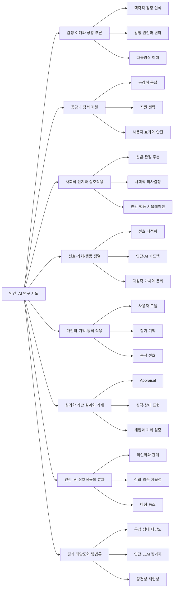

<div align="center">

# Affective Atlas

**인간의 감정·사회적 맥락을 이해하고, 인간에게 유용하게 정렬되는 AI를 위한 연구 지도**

[연구 지도](docs/index.html) · [분야별 문헌·근거](research/REVIEW.md) · [선정·검증 방법](research/METHODOLOGY.md) · [도구 비교](research/TOOLS.md)

</div>

모델의 감정 인식·추론·공감 행동과 **주관적인 감정 경험**은 서로 다른 주장이다. 이 저장소는 관찰 가능한 모델 행동, 심리학적 설명의 검증 가능성, 인간에게 미치는 효과를 중심으로 연구를 연결한다. 인간과 비슷한 언어 표현만으로 의식이나 감정 경험을 추론하지 않는다.

**현재 범위 — 2026-11-10:** 8개 대분류 · 24개 소분류 · 읽기 후보 45편. 출판사 메타데이터·초록과 저자 저장소를 확인한 초기 지도다. 전체 원문 검토나 체계적 문헌고찰, 학계 전체의 인용 순위가 아니다. 기존 수집 데이터 360편과 수동 seed 13편은 보존했다.

> **상태:** 학술 API가 환경 프록시에서 차단되어 인용 수와 논문 간 직접 인용 관계를 수집하지 못했다. 현재 지도에 보이는 선은 **주제 포함 관계**다. 읽기 후보를 피인용 상위 논문이나 검증된 후속 연구로 표시하지 않는다. ICLR·AAAI의 출판사 대조와 전 학회에 대한 균형 잡힌 확장은 미완료다.

## 연구 구조



주제는 상호 배타적이지 않다. 한 논문을 여러 소분류에 연결하며, 주제 분류·직접 인용·내용상 확장·반론을 서로 다른 관계로 저장한다.

## 출발점이 되는 읽기 후보

아래는 인용 수 순위가 아닌 **편집상 읽기 제안**이다. 분야별 전체 후보, 보고된 주장·결과를 담은 출처 초록, 검토할 가설과 한계는 [문헌 검토](research/REVIEW.md)에 있다.

| 분야 | 출발 후보 | 함께 검토할 질문 |
|---|---|---|
| 감정 이해 | [DialogueCRN (ACL 2021)](https://aclanthology.org/2021.acl-long.547/), [ECFlow (ACL 2026)](https://aclanthology.org/2026.acl-long.539/) | 맥락 및 appraisal가 감정 변화 추론에 기여하는가? |
| 정서 지원 | [EmpatheticDialogues (ACL 2019)](https://aclanthology.org/P19-1534/), [ESConv (ACL 2021)](https://aclanthology.org/2021.acl-long.269/) | 공감 표현·지원 전략·사용자 효과는 어떻게 다른가? |
| 사회적 인지 | [FANToM (EMNLP 2023)](https://aclanthology.org/2023.emnlp-main.890/), [SOTOPIA-π (ACL 2024)](https://aclanthology.org/2024.acl-long.698/) | 단일 문항의 신념 추론이 상호작용으로 전이되는가? |
| 선호와 가치 정렬 | [DPO (2023)](https://arxiv.org/abs/2305.18290), [OpinionQA (ICML 2023)](https://proceedings.mlr.press/v202/santurkar23a.html) | 평균 선호 최적화가 누구의 관점을 반영하는가? |
| 개인화와 기억 | [LaMP (ACL 2024)](https://aclanthology.org/2024.acl-long.399/), [The Personalization Trap (ACL 2026)](https://aclanthology.org/2026.acl-short.43/) | 개인 기억이 유용한 맥락과 편향을 어떻게 함께 바꾸는가? |
| 심리학 기반 설계 | [InCharacter (ACL 2024)](https://aclanthology.org/2024.acl-long.102/), [The Practical Impacts… (EMNLP 2025)](https://aclanthology.org/2025.emnlp-main.785/) | 심리학 변수가 동일 예산의 일반 상태 표현보다 유용한가? |
| 인간–AI 효과 | [Humanizing Machines (EMNLP 2025)](https://aclanthology.org/2025.emnlp-main.164/), [Feeling Right vs. Being Right (ACL 2026)](https://aclanthology.org/2026.acl-long.2046/) | 만족·의인화·신뢰·자율성은 어떤 조건에서 충돌하는가? |
| 평가 방법 | [MT-Bench (2023)](https://arxiv.org/abs/2306.05685), [ESC-Judge (EMNLP 2025)](https://aclanthology.org/2025.emnlp-main.811/) | 평가자의 점수가 사람에게 실제로 도움이 되는 상호작용을 예측하는가? |

## 인터랙티브 지도

GitHub README에서는 임의의 JavaScript를 실행할 수 없어 hover 지도를 정적 웹사이트로 제공한다. 생성된 `docs/index.html`을 HTTP로 제공하거나 GitHub Pages로 배포하면 사용할 수 있다. 지도 데이터는 HTML에 함께 포함해 별도 JSON 경로가 없는 미리보기에서도 표시된다. 아직 공개 배포하지 않았다.

- 분야·소분류·역할·연도·텍스트 필터와 읽기 순서/연도/조회된 인용 수 정렬
- 노드 hover: 제목·링크·연도·학회·서지 확인 상태
- 노드 또는 목록 선택: 초록, 출처, 검토 가설, 실험 질문
- 주제 트리와 근거가 있는 논문 관계망의 별도 화면
- CSV와 [Local Citation Network용 JSON](docs/data/local-citation-network.json) 내보내기

그래프 엔진을 새로 작성하지 않고 **vis-network**를 사용한다. **[Local Citation Network](https://github.com/LocalCitationNetwork/LocalCitationNetwork.github.io)**를 [원형 그대로 포함](docs/tools/local-citation-network/)해 직접 인용 탐색, Top Cited/Top Citing, 데이터 내보내기 기능을 재사용한다. 해당 디렉터리에는 원저작권과 GPL-3.0 라이선스를 보존했다. [도구 비교·고정 버전](research/TOOLS.md)을 참조한다.

## 로컬 개발

Python 3.11(CI) 또는 검증된 3.12를 사용한다. 별도 서버나 GPU, LLM API 키는 필요하지 않다.

```bash
python -m venv .venv
source .venv/bin/activate
pip install -r requirements.txt
python scripts/build_research_map.py
python -m unittest discover -s tests -v
python -m http.server 8000 --directory docs
```

브라우저 검증은 Node.js 24와 Playwright를 사용한다. 설치된 시스템 Chromium이
있으면 사용하고, 없으면 Playwright Chromium을 설치한다.

```bash
npm ci --ignore-scripts
npx playwright install chromium  # 시스템 Chromium이 없는 경우
npm run test:browser
```

학술 API 접근 복구 후 인용 데이터를 갱신한다. `--add-citing`은 후보별 최대 20편의 미검토 피인용 이웃을 추가한다. 발견 경로를 주제 관련성이나 내용상 계승의 증거로 해석하지 않는다.

```bash
python scripts/enrich_citations.py --add-citing --max-citing 20
python scripts/build_research_map.py
```

필요한 외부 도메인은 `api.openalex.org`, `export.arxiv.org`다. 본문·출판사 대조에는 `aclanthology.org`, `proceedings.mlr.press`, `proceedings.neurips.cc`, `openreview.net`, `ojs.aaai.org` 등이 추가로 필요하다. 환경 설정에서 기존 규칙을 보존하며 추가한다. 서비스가 인증을 요구하는지는 실제 응답으로 확인한다.

## 데이터와 자동화

| 경로 | 용도 |
|---|---|
| `research/taxonomy.json` | 대·소분류, 검증할 가설과 연구 질문 |
| `research/catalog.json` | 선별 후보, 서지·초록·출처·검토 상태와 논문 관계 |
| `research/REVIEW.md` | 같은 데이터에서 생성한 분야별 검토 문서 |
| `research/sources/` | 저자·출판사 저장소의 확인한 자료 사본 |
| `docs/data/` | 웹 지도, CSV, 외부 도구용 파일 |
| `web/index.template.html` | 화면 문구·구조의 원본. 빌드 시 데이터를 포함한 `docs/index.html` 생성 |
| `papers/papers.csv`, `papers/papers.json` | 기존 키워드 기반 발견 후보. 검증된 연구 지도와 구분 |
| `papers/seed.csv` | 기존 수동 등록 13편. 재검증 전까지 출판 정보 확정에 사용하지 않음 |
| `papers/discovery.md` | 기존 수집기의 발견 보고서 |

기존 GitHub Actions는 매일 06:00 KST에 발견 보고서를 갱신한다. README는 더 이상 수집기가 덮어쓰지 않는다. 출처 오류가 나면 실패로 처리하고 기존 결과를 보존한다. 정적 지도 빌드는 네트워크 없이 실행된다. [Pages 워크플로](.github/workflows/pages.yml)는 수동 실행용이며, GitHub 저장소의 Pages 소스를 GitHub Actions로 설정해야 한다.
