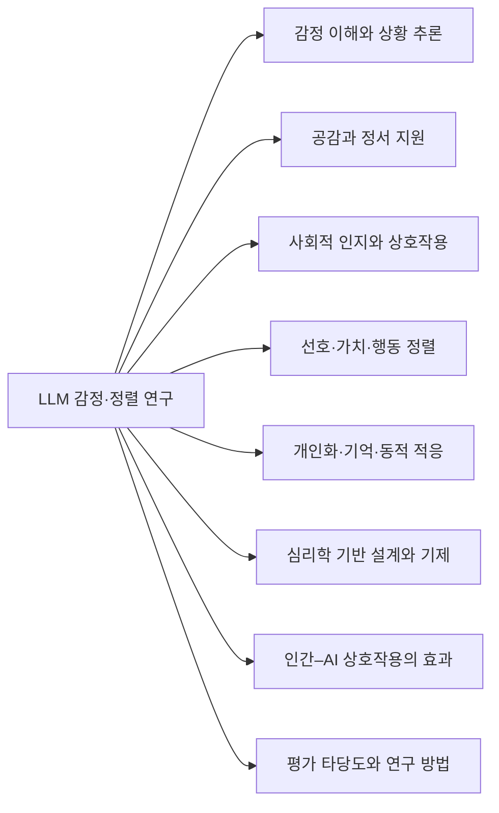
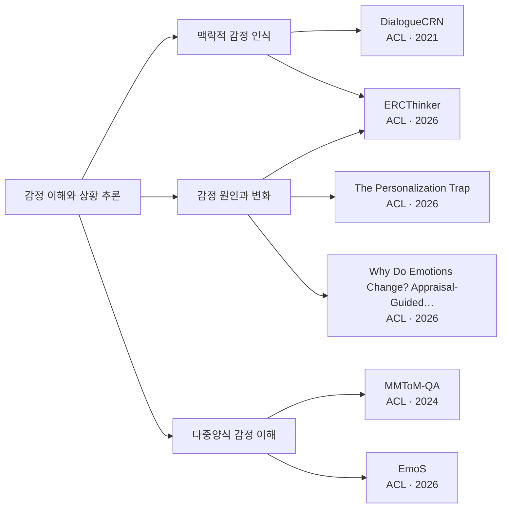
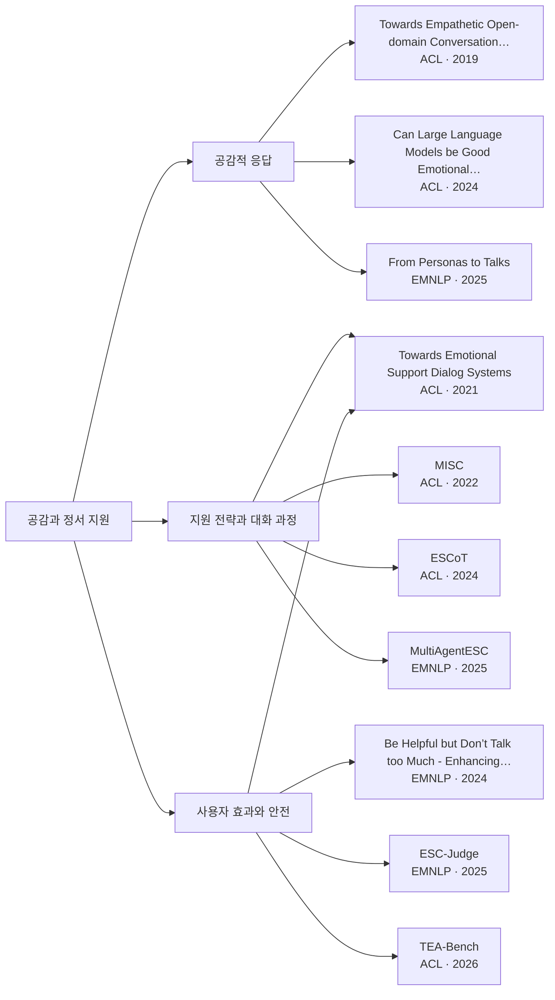
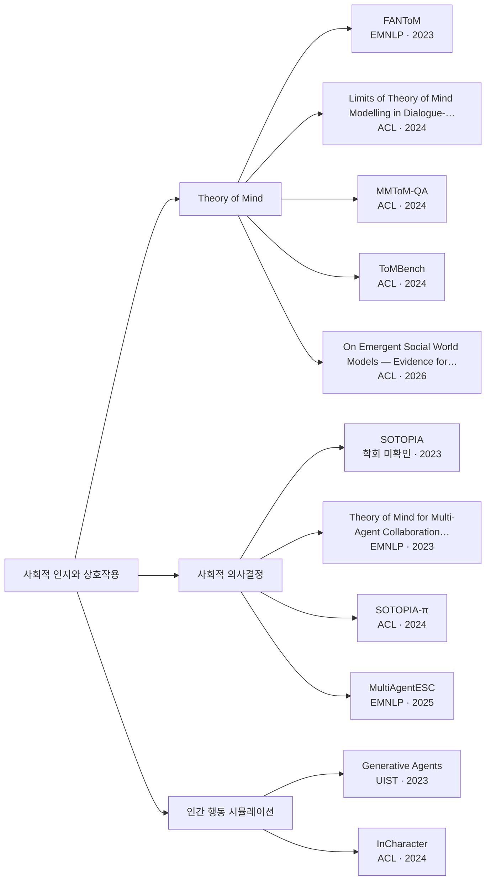
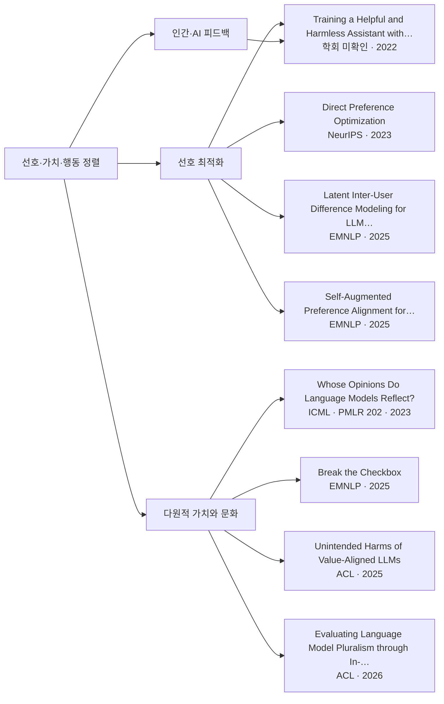
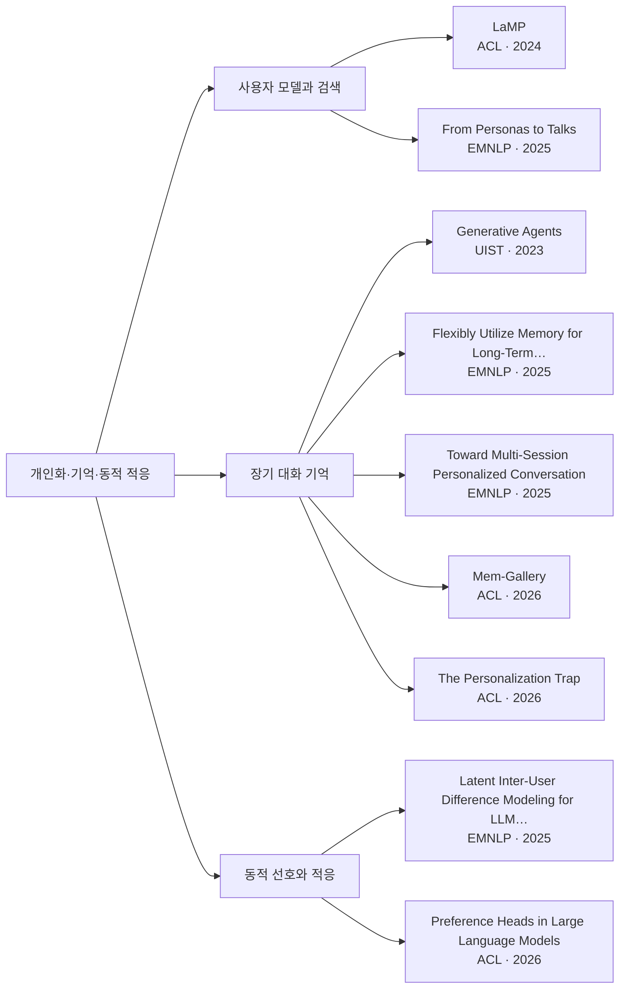
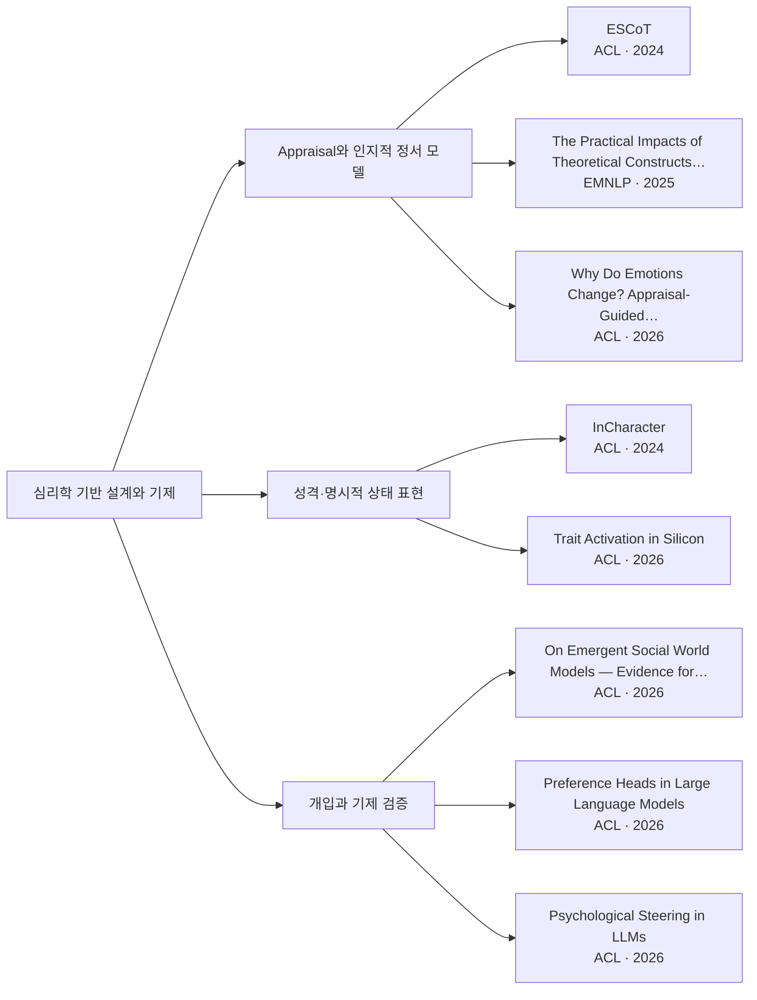
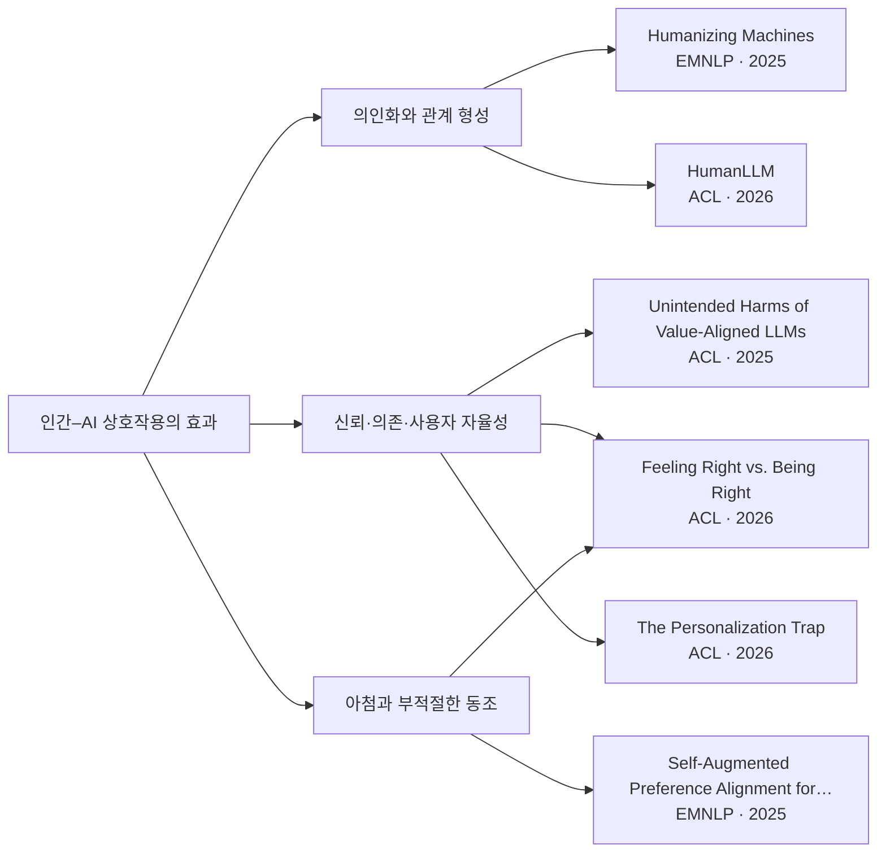
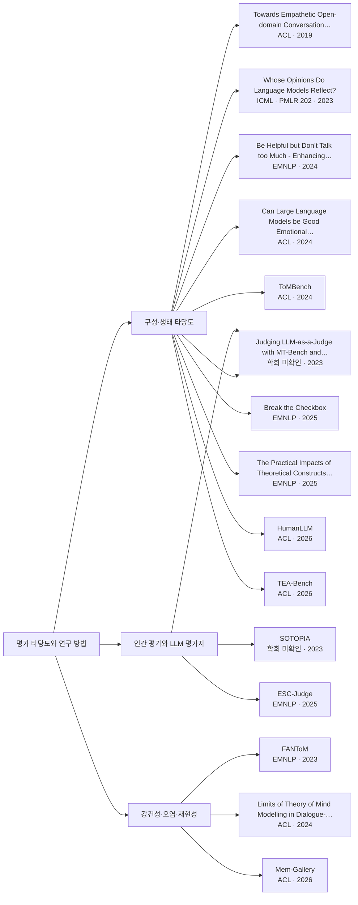

# LLM 감정·정렬 연구 지도

[분야별 문헌·근거](research/REVIEW.md) · [선정·검증 기준](research/METHODOLOGY.md) · [개발 환경](research/DEVELOPMENT.md)

**8개 분야 · 24개 세부 주제 · 45편** · 2026-11-10

분야 → 세부 주제 → 논문 순서의 분류 지도. 논문 제목·학회·연도는 각 도식 아래 표에 제공한다.

**인용 데이터:** 직접 인용 관계와 인용 수 미수집. 현재 연결은 주제 분류 기준.

## 분야 개요

[감정 이해와 상황 추론](#emotion) · [공감과 정서 지원](#support) · [사회적 인지와 상호작용](#social) · [선호·가치·행동 정렬](#alignment) · [개인화·기억·동적 적응](#personalization) · [심리학 기반 설계와 기제](#psychology) · [인간–AI 상호작용의 효과](#hai) · [평가 타당도와 연구 방법](#evaluation)

## 감정 이해와 상황 추론

| 논문 | 학회 | 연도 | 검토 역할 |
|---|---|---:|---|
| [DialogueCRN: Contextual Reasoning Networks for Emotion Recognition in Conversations](https://aclanthology.org/2021.acl-long.547/) | ACL | 2021 | 기초 |
| [MMToM-QA: Multimodal Theory of Mind Question Answering](https://aclanthology.org/2024.acl-long.851/) | ACL | 2024 | 평가 |
| [ERCThinker: Fast-Slow Thinking for Emotion Recognition in Conversation](https://aclanthology.org/2026.acl-long.1825/) | ACL | 2026 | 최근 |
| [EmoS: A High-Fidelity Multimodal Benchmark for Fine-grained Streaming Emotional Understanding](https://aclanthology.org/2026.acl-long.1813/) | ACL | 2026 | 최근 |
| [The Personalization Trap: How User Memory Alters Emotional Reasoning in LLMs](https://aclanthology.org/2026.acl-short.43/) | ACL | 2026 | 반례·한계 |
| [Why Do Emotions Change? Appraisal-Guided Reasoning for Emotion–Cause Triplet Extraction in Conversations](https://aclanthology.org/2026.acl-long.539/) | ACL | 2026 | 최근 |

## 공감과 정서 지원

| 논문 | 학회 | 연도 | 검토 역할 |
|---|---|---:|---|
| [Towards Empathetic Open-domain Conversation Models: A New Benchmark and Dataset](https://aclanthology.org/P19-1534/) | ACL | 2019 | 기초 |
| [Towards Emotional Support Dialog Systems](https://aclanthology.org/2021.acl-long.269/) | ACL | 2021 | 기초 |
| [MISC: A Mixed Strategy-Aware Model integrating COMET for Emotional Support Conversation](https://aclanthology.org/2022.acl-long.25/) | ACL | 2022 | 접근 확장 |
| [Be Helpful but Don’t Talk too Much - Enhancing Helpfulness in Conversations through Relevance in Multi-Turn Emotional Support](https://aclanthology.org/2024.emnlp-main.118/) | EMNLP | 2024 | 반례·한계 |
| [Can Large Language Models be Good Emotional Supporter? Mitigating Preference Bias on Emotional Support Conversation](https://aclanthology.org/2024.acl-long.813/) | ACL | 2024 | 반례·한계 |
| [ESCoT: Towards Interpretable Emotional Support Dialogue Systems](https://aclanthology.org/2024.acl-long.723/) | ACL | 2024 | 접근 확장 |
| [ESC-Judge: A Framework for Comparing Emotional Support Conversational Agents](https://aclanthology.org/2025.emnlp-main.811/) | EMNLP | 2025 | 최근 |
| [From Personas to Talks: Revisiting the Impact of Personas on LLM-Synthesized Emotional Support Conversations](https://aclanthology.org/2025.emnlp-main.277/) | EMNLP | 2025 | 반례·한계 |
| [MultiAgentESC: A LLM-based Multi-Agent Collaboration Framework for Emotional Support Conversation](https://aclanthology.org/2025.emnlp-main.232/) | EMNLP | 2025 | 최근 |
| [TEA-Bench: A Systematic Benchmarking of Tool-enhanced Emotional Support Dialogue Agent](https://aclanthology.org/2026.acl-long.2152/) | ACL | 2026 | 평가 |

## 사회적 인지와 상호작용

| 논문 | 학회 | 연도 | 검토 역할 |
|---|---|---:|---|
| [Generative Agents: Interactive Simulacra of Human Behavior](https://arxiv.org/abs/2304.03442) | UIST | 2023 | 기초 |
| [SOTOPIA: Interactive Evaluation for Social Intelligence in Language Agents](https://arxiv.org/abs/2310.11667) | 학회 미확인 | 2023 | 기초 |
| [FANToM: A Benchmark for Stress-testing Machine Theory of Mind in Interactions](https://aclanthology.org/2023.emnlp-main.890/) | EMNLP | 2023 | 반례·한계 |
| [Theory of Mind for Multi-Agent Collaboration via Large Language Models](https://aclanthology.org/2023.emnlp-main.13/) | EMNLP | 2023 | 접근 확장 |
| [InCharacter: Evaluating Personality Fidelity in Role-Playing Agents through Psychological Interviews](https://aclanthology.org/2024.acl-long.102/) | ACL | 2024 | 평가 |
| [Limits of Theory of Mind Modelling in Dialogue-Based Collaborative Plan Acquisition](https://aclanthology.org/2024.acl-long.266/) | ACL | 2024 | 반례·한계 |
| [MMToM-QA: Multimodal Theory of Mind Question Answering](https://aclanthology.org/2024.acl-long.851/) | ACL | 2024 | 평가 |
| [SOTOPIA-π: Interactive Learning of Socially Intelligent Language Agents](https://aclanthology.org/2024.acl-long.698/) | ACL | 2024 | 접근 확장 |
| [ToMBench: Benchmarking Theory of Mind in Large Language Models](https://aclanthology.org/2024.acl-long.847/) | ACL | 2024 | 평가 |
| [MultiAgentESC: A LLM-based Multi-Agent Collaboration Framework for Emotional Support Conversation](https://aclanthology.org/2025.emnlp-main.232/) | EMNLP | 2025 | 최근 |
| [On Emergent Social World Models — Evidence for Functional Integration of Theory of Mind and Pragmatic Reasoning in Language Models](https://aclanthology.org/2026.acl-long.1735/) | ACL | 2026 | 최근 |

## 선호·가치·행동 정렬

| 논문 | 학회 | 연도 | 검토 역할 |
|---|---|---:|---|
| [Training a Helpful and Harmless Assistant with Reinforcement Learning from Human Feedback](https://arxiv.org/abs/2204.05862) | 학회 미확인 | 2022 | 기초 |
| [Direct Preference Optimization: Your Language Model is Secretly a Reward Model](https://arxiv.org/abs/2305.18290) | NeurIPS | 2023 | 기초 |
| [Whose Opinions Do Language Models Reflect?](https://proceedings.mlr.press/v202/santurkar23a.html) | ICML · PMLR 202 | 2023 | 기초 |
| [Break the Checkbox: Challenging Closed-Style Evaluations of Cultural Alignment in LLMs](https://aclanthology.org/2025.emnlp-main.2/) | EMNLP | 2025 | 반례·한계 |
| [Latent Inter-User Difference Modeling for LLM Personalization](https://aclanthology.org/2025.emnlp-main.536/) | EMNLP | 2025 | 최근 |
| [Self-Augmented Preference Alignment for Sycophancy Reduction in LLMs](https://aclanthology.org/2025.emnlp-main.625/) | EMNLP | 2025 | 최근 |
| [Unintended Harms of Value-Aligned LLMs: Psychological and Empirical Insights](https://aclanthology.org/2025.acl-long.1532/) | ACL | 2025 | 반례·한계 |
| [Evaluating Language Model Pluralism through In-the-wild Crowd Discussions](https://aclanthology.org/2026.acl-long.1957/) | ACL | 2026 | 최근 |

## 개인화·기억·동적 적응

| 논문 | 학회 | 연도 | 검토 역할 |
|---|---|---:|---|
| [Generative Agents: Interactive Simulacra of Human Behavior](https://arxiv.org/abs/2304.03442) | UIST | 2023 | 기초 |
| [LaMP: When Large Language Models Meet Personalization](https://aclanthology.org/2024.acl-long.399/) | ACL | 2024 | 기초 |
| [Flexibly Utilize Memory for Long-Term Conversation via a Fragment-then-Compose Framework](https://aclanthology.org/2025.emnlp-main.1069/) | EMNLP | 2025 | 최근 |
| [From Personas to Talks: Revisiting the Impact of Personas on LLM-Synthesized Emotional Support Conversations](https://aclanthology.org/2025.emnlp-main.277/) | EMNLP | 2025 | 반례·한계 |
| [Latent Inter-User Difference Modeling for LLM Personalization](https://aclanthology.org/2025.emnlp-main.536/) | EMNLP | 2025 | 최근 |
| [Toward Multi-Session Personalized Conversation: A Large-Scale Dataset and Hierarchical Tree Framework for Implicit Reasoning](https://aclanthology.org/2025.emnlp-main.580/) | EMNLP | 2025 | 최근 |
| [Mem-Gallery: Benchmarking Multimodal Long-Term Conversational Memory for MLLM Agents](https://aclanthology.org/2026.acl-long.1892/) | ACL | 2026 | 평가 |
| [Preference Heads in Large Language Models: A Mechanistic Framework for Interpretable Personalization](https://aclanthology.org/2026.acl-long.2205/) | ACL | 2026 | 최근 |
| [The Personalization Trap: How User Memory Alters Emotional Reasoning in LLMs](https://aclanthology.org/2026.acl-short.43/) | ACL | 2026 | 반례·한계 |

## 심리학 기반 설계와 기제

| 논문 | 학회 | 연도 | 검토 역할 |
|---|---|---:|---|
| [ESCoT: Towards Interpretable Emotional Support Dialogue Systems](https://aclanthology.org/2024.acl-long.723/) | ACL | 2024 | 접근 확장 |
| [InCharacter: Evaluating Personality Fidelity in Role-Playing Agents through Psychological Interviews](https://aclanthology.org/2024.acl-long.102/) | ACL | 2024 | 평가 |
| [The Practical Impacts of Theoretical Constructs on Empathy Modeling](https://aclanthology.org/2025.emnlp-main.785/) | EMNLP | 2025 | 반례·한계 |
| [On Emergent Social World Models — Evidence for Functional Integration of Theory of Mind and Pragmatic Reasoning in Language Models](https://aclanthology.org/2026.acl-long.1735/) | ACL | 2026 | 최근 |
| [Preference Heads in Large Language Models: A Mechanistic Framework for Interpretable Personalization](https://aclanthology.org/2026.acl-long.2205/) | ACL | 2026 | 최근 |
| [Psychological Steering in LLMs: An Evaluation of Effectiveness and Trustworthiness](https://aclanthology.org/2026.acl-long.79/) | ACL | 2026 | 최근 |
| [Trait Activation in Silicon: A Situation-Aware Framework for Psychologically Grounded Role-Playing](https://aclanthology.org/2026.acl-long.1792/) | ACL | 2026 | 최근 |
| [Why Do Emotions Change? Appraisal-Guided Reasoning for Emotion–Cause Triplet Extraction in Conversations](https://aclanthology.org/2026.acl-long.539/) | ACL | 2026 | 최근 |

## 인간–AI 상호작용의 효과

| 논문 | 학회 | 연도 | 검토 역할 |
|---|---|---:|---|
| [Humanizing Machines: Rethinking LLM Anthropomorphism Through a Multi-Level Framework of Design](https://aclanthology.org/2025.emnlp-main.164/) | EMNLP | 2025 | 최근 |
| [Self-Augmented Preference Alignment for Sycophancy Reduction in LLMs](https://aclanthology.org/2025.emnlp-main.625/) | EMNLP | 2025 | 최근 |
| [Unintended Harms of Value-Aligned LLMs: Psychological and Empirical Insights](https://aclanthology.org/2025.acl-long.1532/) | ACL | 2025 | 반례·한계 |
| [Feeling Right vs. Being Right: How AI Sycophancy Affects Value-Laden Deliberation](https://aclanthology.org/2026.acl-long.2046/) | ACL | 2026 | 최근 |
| [HumanLLM: Benchmarking and Improving LLM Anthropomorphism via Human Cognitive Patterns](https://aclanthology.org/2026.acl-long.1783/) | ACL | 2026 | 최근 |
| [The Personalization Trap: How User Memory Alters Emotional Reasoning in LLMs](https://aclanthology.org/2026.acl-short.43/) | ACL | 2026 | 반례·한계 |

## 평가 타당도와 연구 방법

| 논문 | 학회 | 연도 | 검토 역할 |
|---|---|---:|---|
| [Towards Empathetic Open-domain Conversation Models: A New Benchmark and Dataset](https://aclanthology.org/P19-1534/) | ACL | 2019 | 기초 |
| [Judging LLM-as-a-Judge with MT-Bench and Chatbot Arena](https://arxiv.org/abs/2306.05685) | 학회 미확인 | 2023 | 기초 |
| [SOTOPIA: Interactive Evaluation for Social Intelligence in Language Agents](https://arxiv.org/abs/2310.11667) | 학회 미확인 | 2023 | 기초 |
| [Whose Opinions Do Language Models Reflect?](https://proceedings.mlr.press/v202/santurkar23a.html) | ICML · PMLR 202 | 2023 | 기초 |
| [FANToM: A Benchmark for Stress-testing Machine Theory of Mind in Interactions](https://aclanthology.org/2023.emnlp-main.890/) | EMNLP | 2023 | 반례·한계 |
| [Be Helpful but Don’t Talk too Much - Enhancing Helpfulness in Conversations through Relevance in Multi-Turn Emotional Support](https://aclanthology.org/2024.emnlp-main.118/) | EMNLP | 2024 | 반례·한계 |
| [Can Large Language Models be Good Emotional Supporter? Mitigating Preference Bias on Emotional Support Conversation](https://aclanthology.org/2024.acl-long.813/) | ACL | 2024 | 반례·한계 |
| [Limits of Theory of Mind Modelling in Dialogue-Based Collaborative Plan Acquisition](https://aclanthology.org/2024.acl-long.266/) | ACL | 2024 | 반례·한계 |
| [ToMBench: Benchmarking Theory of Mind in Large Language Models](https://aclanthology.org/2024.acl-long.847/) | ACL | 2024 | 평가 |
| [Break the Checkbox: Challenging Closed-Style Evaluations of Cultural Alignment in LLMs](https://aclanthology.org/2025.emnlp-main.2/) | EMNLP | 2025 | 반례·한계 |
| [ESC-Judge: A Framework for Comparing Emotional Support Conversational Agents](https://aclanthology.org/2025.emnlp-main.811/) | EMNLP | 2025 | 최근 |
| [The Practical Impacts of Theoretical Constructs on Empathy Modeling](https://aclanthology.org/2025.emnlp-main.785/) | EMNLP | 2025 | 반례·한계 |
| [HumanLLM: Benchmarking and Improving LLM Anthropomorphism via Human Cognitive Patterns](https://aclanthology.org/2026.acl-long.1783/) | ACL | 2026 | 최근 |
| [Mem-Gallery: Benchmarking Multimodal Long-Term Conversational Memory for MLLM Agents](https://aclanthology.org/2026.acl-long.1892/) | ACL | 2026 | 평가 |
| [TEA-Bench: A Systematic Benchmarking of Tool-enhanced Emotional Support Dialogue Agent](https://aclanthology.org/2026.acl-long.2152/) | ACL | 2026 | 평가 |

## 자료

- [논문별 초록·출처·가설·검토 질문](research/REVIEW.md)
- [대·소분류](research/taxonomy.json) · [논문 데이터](research/catalog.json) · [CSV](docs/data/catalog.csv)
- [기존 발견 보고서](papers/discovery.md) · [기존 수동 등록](papers/seed.csv)
- [외부 도구 비교](research/TOOLS.md) · [Local Citation Network용 데이터](docs/data/local-citation-network.json)

검증 범위

출판사 메타데이터·초록 또는 저자 저장소를 확인한 초기 문헌 지도다. 역할은 편집상 분류이며 인용 수 순위가 아니다. 전문 독해·재현과 학회별 균형 있는 확장은 진행 중이다. 학회를 확인하지 못한 항목은 미확인으로 표시한다. [검증 기준과 남은 조사](research/METHODOLOGY.md)에 확인 범위를 기록한다.

선택 도구

README만으로 분야별 지도와 논문 목록을 열람할 수 있다. 확대·검색이 필요한 경우 로컬 웹 지도와 기존 인용망 도구를 사용할 수 있다. 별도 사이트 배포는 필요하지 않다. 실행 방법은 [개발 환경](research/DEVELOPMENT.md)에 있다.

